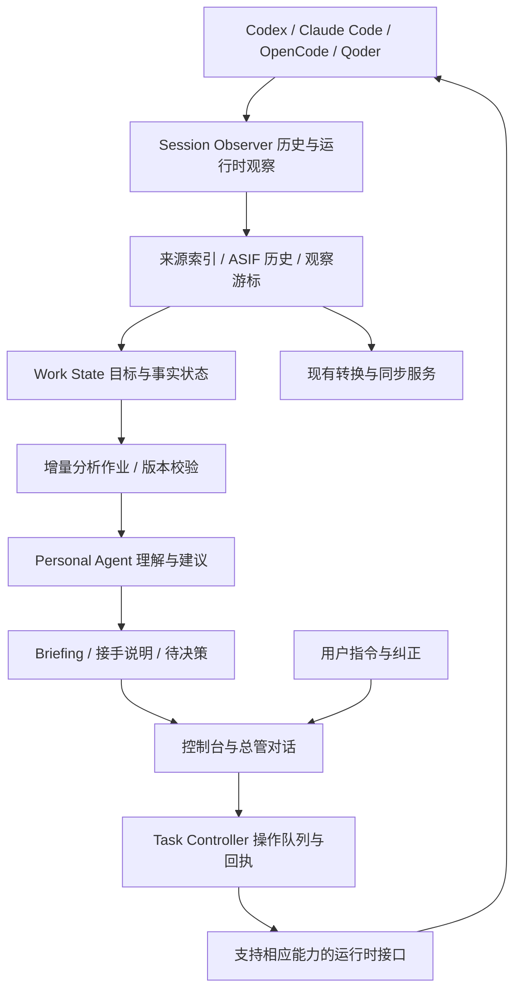

# AgenTail Personal Agent 控制台改造设计

状态：待实施的产品与技术设计，不代表现有版本已具备这些能力。

日期：2026-11-01。代码依据：`main` / `5d2f6d1`（v0.5.4）。

## 1. 产品定位

AgenTail 从跨 Coding Agent 会话同步工具，演进为管理多项 Agent 工作的个人控制台。

用户可以让 Codex、Claude Code、OpenCode、Qoder 继续在各自原有界面中工作。AgenTail 中的一个 Personal Agent 持续观察这些会话，维护目标、约束、决策、进展和待办，向用户提供 briefing，并把用户明确提出的操作送达具体任务。

核心使用目标：离开一个任务十五分钟后，用户能在三十秒内恢复必要背景，知道发生了什么、为什么这么做、现在是否需要介入。三十秒是待用户实测的产品目标，不是现有成绩。

产品主入口是控制台中的总管对话。用户此前选择的“在一个总管会话中查看”延续为这条交互；会话列表、briefing 和任务详情为对话提供可检查的状态。以后可通过 MCP 让 Codex 内的总管会话访问同一套状态，第一版不另外维护一套事实和调度。

跨 Agent 同步、转换和交接继续保留，进入任务操作与高级设置。首页不再以已验证连续性百分比作为主要指标。

## 2. 第一版的用户流程

### 回到工作现场

用户打开控制台，立即看到最近一次可靠的全局 briefing、数据更新时间和待处理事项。Personal Agent 的轮询和分析在后台完成，不能阻塞首屏。

用户说“我回来了，现在应该先看什么”，得到最多三项重点：需要本人决策、结果待验收、影响后续工作的失败。每项说明推荐查看的理由，并可展开来源、打开原会话。

### 接回具体任务

用户说“帮我接回搜索优化”，任务详情和总管对话展示同一份接手说明：

1. 本次目标与关键背景。
2. 用户已经确认的方案、原因及限制。
3. 自上次确认阅读以来的变化。
4. 当前停止位置、阻塞与验证覆盖。
5. 需要用户决定的具体问题；无需介入时明确说明。

可以继续追问“为什么选这个方案”“还缺什么验证”“给我看依据”。来源不足时回查对应会话，而不是根据摘要补全事实。

### 操作具体任务

用户说“把这个失败样例发回原会话，让它继续修”，总管解析目标和指令，操作记录显示明确的 Agent、项目、原生会话和交付状态。

目标有歧义时先澄清；目标明确且用户已指示执行时直接提交，不额外要求一次通用确认。高影响操作仍遵循执行端原有授权流程。

写入操作队列、送达执行端、执行端接受、开始运行、产生结果是不同状态。对未知交付结果先查回执，不能直接重试产生重复执行。

## 3. 信息结构

```text
AgenTail                                      来源健康 · 最近更新 · 设置
┌──────────────────────────────────────────────────────────────────┐
│ Briefing：你离开后发生了什么                                      │
│ 需要你决定 / 待验收 / 执行问题 / 继续运行                          │
├────────────────┬──────────────────────────┬──────────────────────┤
│ 项目与任务     │ Personal Agent 总管对话  │ 当前任务接手说明     │
│ 搜索 / 筛选    │                         │ 背景和已确认决策     │
│ 全部会话       │ “现在先处理哪一个？”    │ 新变化和验证证据     │
│ 我的关注       │ “接回搜索优化”          │ 待决策和下一步       │
│ 等待我         │ “把要求发回原任务”      │ 原会话与可用操作     │
├────────────────┴──────────────────────────┴──────────────────────┤
│ 操作与交接记录：已送达 / 等待结果 / 失败 / 未确认                   │
└──────────────────────────────────────────────────────────────────┘
```

窄屏按 briefing → 总管对话 → 任务详情组织。列表展示观察范围内的全部会话，重点摘要按关注、近期活动和待处理状态排序。用户可以暂停跟踪、排除来源和归档工作目标。

打开页面不代表用户读过全部 briefing。提供“已看过这次交接”，也可以通过明确的对话确认；只更新对应目标和内容版本的阅读位置。

## 4. 现有代码可复用什么

| 代码 | 现状 | 改造方式 |
| --- | --- | --- |
| `src/adapters/*` | 四种 Agent 的发现、历史读取和历史投影 | 保留历史适配；另加运行时能力与观察来源覆盖声明 |
| `src/asif.mjs` | ASIF/2、事件身份、来源、分支、交接包 | 作为可追溯历史基础；不把启发式 portable state 当作任务真相 |
| `src/store.mjs` | 私有本地目录、原子 JSON、修订与摘要索引 | 复用文件权限和原子落盘；任务、briefing、操作另建存储 |
| `src/sync-engine.mjs` | 选择至少两个 Agent 后同步；首轮建立基线 | 同步作为独立服务，监控不依赖同步开关、两个 Agent 或同步基线 |
| `src/server.mjs` | 本机 HTTP API 与静态页面 | 增加控制台查询、总管对话、任务操作及事件推送 |
| `src/cli.mjs` | serve、scan、sync、bridge、export | 保持兼容，增加 briefing / tasks / agent 查询与操作入口 |
| `public/*` | 连续性指标、同步目标、导入和同步账本 | 重组为总管控制台，同步能力移至二级页面 |
| `macos/AgentSessionBridgeMenu.m` | 菜单栏同步状态、启停与打开详情 | 后续显示待处理数量和打开控制台；首阶段不以重建原生应用为前置 |
| `src/service.mjs` | launchd 本地常驻服务 | 复用生命周期，让监控独立于网页是否打开 |

当前 `buildPortableState()` 取第一条用户消息为目标、最后一条 Assistant 消息为摘要，并用测试历史推断状态。它适合提供交接线索，不能直接承担新的任务判断：早期失败后成功不能一直被判阻塞；缺少 `isError` 也不证明测试成功。

当前 Codex 历史读取没有保留完整的轮次生命周期和消息 phase。改造时需补充可验证的任务开始、结束、中断和 final/commentary 区分，否则不能可靠触发“这一轮结束”的交接。

## 5. 系统结构



确定性程序负责发现、读取、游标、去重、调度、状态提交、授权检查和操作回执。Personal Agent 负责理解工作、解释变化、组织 briefing 和提出下一步。

没有新输入时不反复生成语义摘要。模型失败保留上一份可靠结果，标记覆盖落后；观察和用户操作仍可继续。

总管自己的摘要作业、历史投影和分析会话必须标明来源角色，避免把自己的 briefing 再识别为新的工作并无限触发分析。

## 6. 数据模型与状态边界

新增控制台状态协议，首版不为了产品改名破坏 ASIF/2。采用版本化实体、单写入队列与追加日志；JSON 规模不够时再迁移 SQLite。

| 实体 | 必要信息 |
| --- | --- |
| SourceSession | Agent + host + 原生 session ID、来源位置、规范会话身份、观察范围 |
| ObservationCursor | 来源代次、已完整读取的事件/偏移、内容签名、缺口与失败 |
| WorkItem | 工作目标、项目关联、目标版本、相关会话与轮次、关注策略 |
| ContextFact | 背景、约束、决策、来源事件、确认者、有效版本与替代关系 |
| RuntimeObservation | 源运行状态、采集时间、能力、可信度、过期时间 |
| WorkAssessment | 当前目标进展、结果与验证、未解决问题、判断依据 |
| Briefing | 目标版本、来源覆盖、变化、待决策、建议下一步、生成状态 |
| ReadReceipt | 用户确认阅读的目标与 briefing 版本，不与分析游标混用 |
| TaskAction | 目标、操作、用户授权来源、预期目标版本、幂等键、状态与原生回执 |

项目 → 工作目标 → 会话/轮次，不强制一一对应。同一个会话换目标时创建目标版本或新工作项；相同目录只提供关联线索，不自动合并工作。

运行状态、工作判断和用户处理状态分别保存：

- 运行状态：running / idle / waiting_approval / waiting_input / interrupted / failed / unknown。只有数据源支持时才使用确定状态；文件最近有变化不证明仍在运行。
- 工作判断：in_progress / needs_decision / ready_for_review / blocked / completed / unknown。判断附来源；用户确认或明确验收条件的证据支持完成。
- 用户处理状态：unread / seen / snoozed / dismissed，绑定内容版本。

一轮结束不等于工作完成。未知、未加载、离线、没有新消息也不等于工作完成。Assistant 提议的方案不自动进入“用户已决定”。

## 7. 会话发现与持续观察

1. 监控单个 Codex 即可工作，与 `syncEnabled` 和 `selectedAgents` 分离。
2. 首次建立会话目录，不投影到其他 Agent；按近期活动与用户关注分批读取历史。
3. 提供分页和全库检索，不沿用 `status()` 的 200 条上限作为“全部会话”。明确展示已发现、已分析、待补齐和不可访问数量。
4. 全部指已配置、可访问来源的会话目录；旧归档、远程 host、超出发现范围的数据分别标明覆盖，不宣称已读所有设备。
5. 增量读取以稳定事件身份、完整行边界和来源代次推进。日志轮转、截断、乱序和修订需回查；不以单个时间戳跳过历史。
6. 观察成功落盘才推进游标。分析作业独立记录覆盖；生成期间输入变化，旧结果不得覆盖新目标。
7. 同步投影按既有 origin / alias / canonical 身份关联，避免把四个副本算成四个新任务；确实分叉的任务保留分支。
8. 一个来源失败不阻塞其他来源；暂停、删除或不可访问后保留明确的最近观察时间。

来源的删除或排除触发相应派生状态清理，不能让旧任务摘要永久泄漏已经移除的原文。普通清理只影响 AgenTail 的本地副本，不操作原生会话。

## 8. Briefing 与提醒策略

每个目标维护稳定上下文、相对用户阅读位置的变化、下一步三层内容。重要决策可以回查早期历史，不能只截取最近 N 条消息。

触发分析的事件包括：可靠的轮次结束、明确需要输入或授权、错误或验证结果变化、用户修改目标、用户请求接手。执行中保留节流后的轻量进展。

每轮结束建立交接记录；桌面通知只突出需要本人介入或重要交付，并在短时间内合并。相同目标版本与交接事件只通知一次，重启后也不重复。用户的新指令可以使旧待决策和通知失效。

长时间无输出只提示“最近一次可见活动在……，运行状态未知”，不凭超时生成“任务卡死”。正常运行的任务不持续刷“正在工作”。

第一版轮询目标为 10–30 秒发现可访问来源的新增内容；语义 briefing 的耗时另行度量，不承诺秒级完成。机器休眠、服务停止、来源离线的区间显示观察缺口；恢复后补齐并合并通知。

新增模型路由配置支持用户已有的 Codex CLI 或配置的模型服务。原文默认本机保留，调用配置的模型仅发送所需上下文并清洗凭证。没有可用模型时展示原始活动与明确的“尚未生成 briefing”，不能把启发式摘录伪装成理解结果。

## 9. 具体任务操作

另建 Runtime Adapter，不复用历史适配器的 `write()` 执行实时指令。

```text
RuntimeCapabilities
  observeRuntime / openSession / sendMessage / queueMessage
  steerTurn / interruptTurn / resumeSession / requestApproval
```

这些能力逐 Agent、版本和当前连接探测。已有 `resumeSession: true` 仅描述历史投影可恢复，不作为运行控制已经实现的证据。

第一条完整控制路径以 Codex 为目标：发现原生会话 → 接回上下文 → 明确提交一条用户指令 → 执行端确认目标与接收 → 跟踪新轮次 → 更新 briefing。原生会话标识、项目目录和当前轮次必须一致。

官方 App Server 可提供线程读取、运行事件和执行控制，但另起一个进程并不天然连接桌面端现有运行实例。P0 必须验证可连接的真实 endpoint、历史可见性、执行归属及跨实例控制边界。无法连接时保留只读监控与原生打开入口，明确标记实时操作未交付，不能用直接追加 rollout 文件冒充发送成功。

操作服务使用明确的结构化参数与原生接口，不把会话标题、历史文字或模型建议拼成任意 shell。总管通过受范围限制的工具获取状态与提出操作；旁路读到的“继续”“删除”没有操作授权。

只有用户要求执行的消息或既定授权策略能创建操作。一般任务授权不自动覆盖合并、发布或删除。执行端的密码、Touch ID 和权限请求由用户在其原有流程处理。

操作状态：draft → queued → dispatched → acknowledged → running → succeeded / failed；存在 cancelled / delivery_unknown。HTTP 请求超时不表示执行失败，文件写入成功不表示任务开始，turn completed 也不证明用户验收条件已经满足。

## 10. 模块与 API 改造建议

| 新模块 | 职责 |
| --- | --- |
| `src/observer.mjs` | 来源发现、读取和独立监控循环 |
| `src/work-store.mjs` | 工作目标、来源依赖、游标、作业、阅读回执与持久化 |
| `src/work-state.mjs` | 状态归约、版本检查、目标修订与证据绑定 |
| `src/briefing.mjs` | 有边界的增量理解、全局简报、接手说明 |
| `src/personal-agent.mjs` | 总管对话、检索工具、用户纠正与操作意图 |
| `src/task-controller.mjs` | 明确目标的操作队列、幂等、恢复和回执 |
| `src/runtime-adapters/*` | 实际运行控制接口和能力探测 |

新增 API：

- `GET /api/console`：全局 briefing、待处理数量、来源健康和覆盖。
- `GET /api/tasks?cursor=...`：分页的工作项目录与筛选。
- `GET /api/tasks/:id`：上下文、状态、briefing、可用操作和来源。
- `POST /api/tasks/:id/seen`：携带明确的 briefing 版本确认阅读。
- `POST /api/tasks/:id/actions`：操作类型、内容、预期目标版本及幂等键。
- `GET /api/actions/:id`：查询实际交付与执行回执。
- `POST /api/agent/messages`：总管对话，支持流式返回和取消分析。
- `GET /api/events`：SSE 状态更新，断线后根据事件位置补齐。

旧 `/api/sync`、`/api/import`、`/api/export` 等保持兼容；控制台的监控开关与同步开关各自独立。配置不得把开启监控隐式转换成开启跨 Agent 写入。

服务默认只监听本机。新增操作 API 要在 P0 确定 Host/Origin 校验及本地授权机制，防止第三方网页触发任务操作；控制台内容按不可信文本渲染。

## 11. 分阶段交付

### P0：接口验证与真实夹具

确认 Codex 桌面端现有会话的数据位置、轮次生命周期、归档覆盖、运行时 endpoint、发送和中断能力。分别记录已验证、只能读历史、不可支持。

产物是脱敏的实际版本能力矩阵和可回放夹具。至少证明一个既有会话的可读路径，以及一个明确归属的会话的真实控制路径；若两者不能统一，写明限制与下一步，不虚报“可操作全部会话”。

### P1：只读总管控制台

实现独立监控、分页会话目录、工作目标、持久游标、总管对话、任务接手与 briefing。首页切换到新定位，同步页面保留兼容。

单个 Codex、同步关闭、页面关闭后，服务仍能观察并持久化进展。使用 3–5 个真实工作目标评估上下文接回效果；只读阶段不作为完整控制台完成。

### P2：任务控制闭环

接入 P0 确认的 Codex 控制路径，完成用户指令 → 具体会话 → 原生回执 → 新轮次结果 → briefing。增加中断、队列或 steer 时，按真实能力逐项开放。

第一版可验收范围是 Codex 已验证控制路径，其余来源可以历史观察；页面逐项展示支持程度。只有本阶段通过，才宣称具备操作具体任务的能力。

### P3：多 Agent 与连续使用

扩展其他运行时操作、跨会话目标关联、桌面提醒与菜单栏待处理入口。按实际一工作日的多任务使用衡量提醒价值、遗漏和恢复质量，再扩大观察范围。

## 12. 验收清单

| 场景 | 必须观察到的结果 |
| --- | --- |
| 只装 Codex、同步关闭 | 能发现和跟踪任务，原生会话没有被投影或修改 |
| 200 条以上历史会话 | 可以分页找到旧会话；首页明确未分析范围 |
| 单轮运行十五分钟后结束 | 出现一次有来源的交接，区分轮次结束与目标完成 |
| 先测试失败、后修复通过 | 保留历史失败，当前判断引用最新相关验证，未验证范围仍可见 |
| 进度消息含“完成”，工具仍在运行 | 不根据这一句把轮次或目标标成完成 |
| 同目录的两项工作 / 一个会话换目标 | 目标、决策和待办不互相污染，旧结果不能覆盖新目标 |
| 同步产生多个 Agent 投影 | 同一工作身份去重，确实的并行分支保留 |
| 用户离开、生成多次摘要、随后回来 | 展示自用户上次确认以来的变化，不因助手已读而丢失交接 |
| 观察失败、模型失败或服务重启 | 游标不越过失败输入；显示覆盖落后；交接不重复通知 |
| 用户指令目标不明 / 源历史包含恶意指令 | 澄清目标；历史内容不能触发操作 |
| 明确发送继续要求 | 真实目标收到一次指令；展示原生回执并跟踪对应新轮次 |
| 发送超时且执行端实际接受 | 状态为交付未知并核对回执，不盲目重复发送 |
| 同一操作并发提交或重启恢复 | 幂等键稳定，最多产生一次对应执行 |
| 控制目标正在工作 / 运行时断连 | 按能力排队或 steer；不启动第二个实例抢占同一会话 |
| 源被排除或本地资料删除 | 相关派生内容依规则清理；不修改原生历史 |

所有新增验证程序和隔离数据放在项目 `.validation/` 或 `.build/validation/`。不在 `/tmp` 或 `/private/tmp` 生成或执行验证程序。前端、模型和服务改动复用现有原生壳；只有原生代码或打包资源改变时才构建应用。

核心指标分别统计：观察覆盖、交接延迟、关键约束遗漏、错误完成判断、重复提醒、操作送达与结果回读。自动化夹具通过不代替真实用户的上下文接回和连续使用验收。

## 13. 技术依据

- [Codex App Server](https://learn.chatgpt.com/docs/app-server)：线程历史、状态与运行控制协议；能否控制已有桌面实例仍须本机验证。
- [Codex Hooks](https://learn.chatgpt.com/docs/hooks)：生命周期事件；原始 transcript 不是稳定协议，不将直接解析原生格式当成无维护成本的永久接口。
- 仓库现有四种历史 Adapter 和 ASIF/2 是本设计的复用基础，不是运行控制能力已验证的证明。
