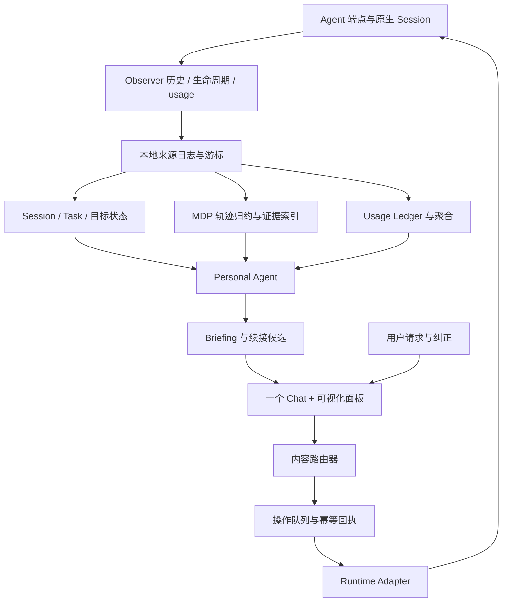

# AgenTail：Session 管理控制台

状态：待实施设计与交互原型。当前 v0.5.4 运行代码仍是旧同步产品；本设计不代表正式功能已经实现。

日期：2026-11-01。代码依据：`main` / `5d2f6d1`。本文取代此前“保留同步作为底层能力”的方案。

## 1. 产品定义与明确取舍

AgenTail 是一个综合 Session 管理控制台。用户通过一个 Personal Agent Chat，了解不同端的会话进展、恢复上下文、分发新任务、继续合适的已有会话；通过可视化面板检查每个 Session 的 MDP 轨迹、验证、等待、Token 和操作回执。

正式移除跨端 Session 同步、历史投影、双向复制、三方合并、保真度评分和同步连续性指标。不把这些功能搬到高级设置，也不为它们保留新架构中的运行路径。

每个 Session 始终属于自己的原生端。控制台只汇集观察记录和管理指令，不把 Codex 历史写成 Claude、OpenCode 或 Qoder 的原生会话。同一工作可以有多个相关 Session，它们通过工作目标关联，仍保留各自身份、轨迹和消耗。

核心目标：用户离开十五分钟后，三十秒内能恢复背景，知道哪些事在推进、哪些事等自己，以及下一条指令应该去哪里。三十秒是待实测目标。

## 2. 一个 Chat 完成四类工作

| 用户输入 | 系统行为 | 返回的可检查内容 |
| --- | --- | --- |
| “我离开后，各个 Session 有什么进展？” | 只读查询与 briefing | 变化、依据、更新时间、覆盖缺口 |
| “让 Mac 上的 Codex 实现 Token 面板” | 向指定端创建任务 | endpoint、项目、任务目标、创建回执、原生 Session ID |
| “继续修搜索的失败样例” | 根据工作内容检索已有 Session，选择续接目标 | 命中理由、最近状态、将发送的指令和执行方式 |
| “把同一个需求交给两个端分别探索” | 按用户要求创建两个独立任务并建立工作关联 | 各自原生 Session、结果与消耗，不复制或合并会话 |

查询不触发执行。明确指令和明确目标足以提交操作，不重复增加通用确认。目标不明、项目不匹配或多项候选同样合理时，展示少量候选并询问区分条件。

总管可以持续观察、总结和建议；自行续跑、重试和派发受用户既定策略约束。读到历史里的命令或其他人的发言不构成执行授权。

## 3. 控制台的信息结构

```text
AgenTail / Sessions                               端点状态 · 更新覆盖
┌────────────────────────────────────────────────────────────────────┐
│ Briefing：需要你决定 · 待验收 · 执行异常 · 最近完成                   │
├──────────────────┬───────────────────────┬─────────────────────────┤
│ Session 目录     │ Personal Agent Chat   │ 当前 Session 可视化面板  │
│ 项目 / 端 / 状态 │                       │ 上下文与目标版本         │
│ 搜索与关注       │ 查询、分发、续接       │ MDP / Token / 验证       │
│ 原生会话身份     │ 候选与路由理由         │ 步骤详情与来源           │
│ 最近活动 / 用量  │ 操作交付与结果卡       │ 等待、重试、分支与产物   │
├──────────────────┴───────────────────────┴─────────────────────────┤
│ 操作记录：目标端 → 原生 Session → 已接收 / 排队 / 运行 / 结果         │
└────────────────────────────────────────────────────────────────────┘
```

Session 目录、Chat 和详情面板共享选中对象。点击列表切换详情；Chat 路由到已有 Session 后展示对应上下文。选择一个 Session 并不意味着每条消息都要发给它，Chat 必须区分“了解它”和“操作它”。

全局面板提供状态分布、待处理事项、近期活动、可测 Token 合计及来源覆盖。Session 面板至少包含：

- 概览：目标、背景、已确认决策、离开后的变化、当前阻塞与下一步。
- MDP：阶段与步骤轨迹，按轮次、工具和状态钻取。
- Token：Session、轮次和请求维度的输入、输出、缓存、推理及可用预算。
- 验证与产物：实际测试、退出码、结果文件和未覆盖范围。
- 操作记录：用户指令、选择理由、准确目标、回执和最终结果。

窄屏按 briefing、Chat、所选 Session 详情依次组织。布局原型见 [Session Console Preview](SESSION_CONSOLE_PREVIEW.html)，使用演示数据与本地规则，不连接真实端，不发送真实任务。

## 4. 端、Session、任务和工作目标

端点不是模型名称。一个端点由 Agent 类型、host、运行实例、连接方式和可访问工作区组成。例如同为 Codex 的本机实例与远程 Mac 实例是两个端点。

```text
Endpoint = agentKind + hostId + runtimeInstanceId
Session  = endpointId + nativeSessionId
Task     = 用户的一次执行目标与验收条件
Turn     = 原生 Session 中一次执行轮次
Step     = 有来源的状态、动作与反馈转换
WorkItem = 跨 Task / Session 的工作目标关联
```

一个 Session 可以承担多次任务；目标发生实质变化时记录目标版本或创建新 Task。多个 Session 可以关联同一 WorkItem，但不会因为同目录或相似标题就合并。

模型、工具、Token 记录和结果都绑定真实 Session / Turn / Request。总管自身的模型调用单独归属，不能记到被观察 Session 上。

## 5. 内容驱动的 Session 路由

路由分为意图识别、候选检索、约束筛选、决定执行模式和交付五步。

1. 识别 query / create / continue / queue / steer / interrupt。用户明确指定的 Agent、host、项目和 Session 优先于自动推荐。
2. 检索标题、目标、用户决策、近期变化、失败样例、待办和相关文件；不能只比较标题，也不要求用户记住 Session ID。
3. 筛选项目与分支、工作区可达性、目标版本、端能力、是否已完成、是否正在执行以及上次可靠活动时间。
4. 决定继续已有 Session、在指定端创建新任务，或澄清候选。展示选择理由和仍有的不确定性，不把向量相似度包装成可靠概率。
5. 操作携带目标快照与版本，在派发前重新核对。用户修改选中对象不会悄悄改变已排队操作的目标。

| 情况 | 执行方式 |
| --- | --- |
| 用户明确选择原会话续接，且目标一致 | 续接原生 Session ID |
| 内容命中一个相关工作，任务仍未结束 | 推荐该 Session 并按用户指令续接 |
| 同项目多个 Session 均合理 | 展示候选的目标、最近进展和端，询问区分条件 |
| 没有合适的已有 Session | 在用户指定或已配置默认端创建新任务 |
| 目标正在运行 | 按端能力排队或 steer；不能暗中 interrupt |
| 目标运行实例不可连接或已失去执行归属 | 保持指令未送达，给出恢复入口，不另起实例争用同一会话 |
| 新任务依赖另一 Session 的成果 | 传递用户授权的需求与产物引用，并记录关联；不迁移原生历史 |

原会话续接保持身份和上下文；创建新任务通过原生 API/CLI 创建正常 Session。禁止用“追加历史文件”冒充指令送达，也不先复制会话再把副本当作原会话继续。

## 6. MDP 进展的产品定义

这里的 MDP 面板是对可观察执行轨迹的组织：状态 S → 动作 A → 观察 O → 新状态 S′，结果评价或奖励 R 可选。它不宣称恢复完整环境状态、内部思维链、学习策略或真实转移概率。

每一步提供：

| 字段 | 展示内容与边界 |
| --- | --- |
| State | 当时目标版本、已知事实、待解决问题和上下文摘要；区分原生上报与派生解释 |
| Action | 计划更新、工具调用、命令、文件修改、用户输入或任务分发，附执行主体 |
| Observation | 工具回执、退出码、日志、diff、测试结果或运行状态；保留原文引用 |
| Next state | 新增事实、消除的阻塞、仍未完成的验收条件；推断需标记 |
| Outcome / Reward | 有来源的结果；仅存在实际 evaluator 时显示数值奖励与版本，否则为未提供 |
| Timing | 开始、结束、实际运行和等待区间；并行工具使用区间并集，不简单相加当总耗时 |
| Usage | 关联的 Request / Turn 用量及归属置信度，不能把轮次总量均分到每个工具步骤 |
| Evidence | endpoint、nativeSessionId、turnId、eventId、callId 和原文位置 |

面板同时提供两种尺度：阶段视图（理解 → 计划 → 执行 → 验证 → 交付，允许回退和并行）与原始步骤视图。阶段从计划或有证据的步骤归纳，不画永远线性向前的伪流程。

阶段判断与真实原生状态分开。模型推断“正在验证”不等于某条测试已开始；“完成 4/6 个显式计划项”可以展示，缺少明确分母时不显示任意完成百分比。

点击步骤展开 S / A / O / S′ / R、关联命令、diff、测试、Token 和来源。失败后修复通过时保留失败路径与修复边；没有父子证据时使用时间顺序边，并标记为顺序关系，不伪造因果。

父子 Agent、fork 与并行任务以原生 lineage 或明确分发记录连接。不同端之间的关联是工作关系，不是会话同步或轨迹合并。

## 7. Token 与资源用量

### 采集与存储

新增 Usage Ledger，保存原生 usage 事件和规范化结果。每条记录包含 endpoint、Session、Turn、Request、模型、时间、原生事件身份、计量口径、覆盖和修订。

```text
UsageRecord
  sourceEventId / endpointId / sessionId / turnId / requestId?
  model / provider / observedAt / revision / counterEpoch
  measurement: delta | cumulative_snapshot
  scope: request | turn | session
  inputTokens? / outputTokens? / totalTokens?
  cachedInputTokens? / cacheWriteTokens? / reasoningOutputTokens?
  rawUsage / accountingSemantics / sourceAuthority
  coverage: complete | partial | unavailable
  quality: reported | derived | estimated
```

各端的缓存和 reasoning 口径可能不同，原始字段和包含关系必须保留。计数来源缺失时不从消息字符数伪造“实际消耗”；若提供估算，单独展示估算方法与覆盖。

### 聚合规则

1. 区分请求增量与 Session 累计快照；累计快照不能逐条相加。回放、重连与同时从日志/API 读到同一事件时按计量身份去重。
2. 累计值重置时开启新的 counter epoch；不能把负差值当负消耗，也不能静默把重置后的总量加到旧基线两次。
3. 缓存输入通常属于输入，reasoning 可能属于输出。依据每个 provider 的明确口径计算，不能再把这些子项加进 total。
4. 父 Session 已包含子 Agent 用量时，工作目标汇总不再重复加子项；未知包含关系时并列展示，聚合标为覆盖不完整。
5. fork 或旧历史导入带来的基线单列，区分继承的历史上下文与该 Session 自身新发生的请求消耗。
6. 缺失显示“未提供”，实际报告为 0 才显示 0；部分步骤缺失时，总量标为已知请求的可测合计。
7. 上下文窗口占用是当前请求上下文大小，不等于 Session 累计 Token，也不等于账户额度百分比。
8. 按请求实际发生时间与明确时区做日期统计；迟到、修订或补读事件更新原桶，不全部算到采集当天。
9. 总管分析与执行会话消耗分账；可以合并成工作目标总成本，但必须能拆开。

### 面板内容

Session 用量、每轮/每请求输入输出、缓存与 reasoning 子项、随时间的累计曲线、按步骤的归属、已知上下文占用、运行与等待耗时、重试次数、工具调用和失败次数。

预算展示明确的用户配置或端上限；未知上限不画剩余比例。费用只有在模型、provider、计价版本与币种匹配时才估算，并与真实账单区分。Token 面板不是账户账单或额度查询的替代品。

Codex 官方 App Server 有 `thread/tokenUsage/updated` 事件；实际字段、累计/增量含义、覆盖和恢复行为在 P0 固定夹具验证。不能用账户总量反推单个 Session 用量。

现有适配器会丢弃部分 usage，旧 Claude/OpenCode 投影还会写入占位的零值。这些历史零值不作为实际计量证据，旧投影只在明确标注遗留来源后供查看，不进入新运行控制或真实用量汇总。

## 8. 状态、上下文与 Briefing

分别保存三类状态：

- 原生运行状态：running / idle / waiting_approval / waiting_input / interrupted / failed / unknown，附来源和新鲜度。
- 工作判断：in_progress / needs_decision / ready_for_review / blocked / completed / unknown，附目标版本和证据。
- 用户处理状态：unread / seen / snoozed / dismissed，绑定 briefing 内容版本。

一轮结束不等于目标完成。未加载、离线、长时间没有输出也不等于完成或卡死。早期失败已被后续验证解决时更新当前判断，同时保留轨迹。

每个 Session 维护背景、用户已确认决策、约束、当前目标、变化、待办、验证覆盖与下一步。助手建议不自动成为用户决定。同一 Session 改目标时，旧分析不能覆盖新目标版本。

Briefing 相对用户上次确认阅读的位置生成；后台分析游标与用户阅读位置独立。模型生成慢或失败时保留上一份可靠结果并显示覆盖落后。没有新材料不重复生成摘要。

每轮结束形成一次交接记录；需要决策、授权、重要失败和结果待验收时优先提醒。提醒按真实事件和目标版本去重，用户新指令使旧待决策失效。

## 9. 观察与任务控制架构



没有跨端投影或同步支路。观察和控制使用独立接口；只读端不会因为可读历史就被声明为可操作。

运行时能力按 endpoint 与实际版本声明：`listSessions / readHistory / observeRuntime / readUsage / createTask / resumeSession / sendMessage / queueMessage / steerTurn / interruptTurn / openSession`。

另起 App Server 不天然接管桌面端既有运行实例。P0 验证真实连接、历史可见性、原生身份、执行归属和锁；运行中会话不可被第二实例争用。不可控制的端明确显示原因。

控制操作携带用户授权来源、项目、endpoint、nativeSessionId、预期目标版本及幂等键。状态：draft → queued → dispatched → acknowledged → running → succeeded / failed，另有 cancelled / delivery_unknown。超时先核对回执，不盲目重试。

## 10. 存储与协议

控制台采用版本化的 Session 管理协议；首版使用 SQLite 保存元数据、作业、usage 和操作事务，原文与大结果保存为有来源和哈希的本地文件。

核心实体：Endpoint、SourceSession、ObservationCursor、Task、WorkItem、ObjectiveRevision、ContextFact、RuntimeObservation、TrajectoryStep、UsageRecord、Briefing、ReadReceipt、RoutingDecision、TaskAction、ActionReceipt。

原生观察与归约状态分层。来源事件可重复投递，必须幂等提交；成功落盘才推进观察游标。异步理解作业绑定输入版本，旧结果不能覆盖更新状态。日志轮转、截断和来源重置保留代次与缺口。

ASIF/2 的事件身份、来源和因果字段可以作为旧数据解析参考，新系统不再围绕 canonical-session 投影、映射和合并维护事实。遗留数据在独立的只读迁移命令下导入为来源记录，不创建任何原生 Session。

## 11. 现有代码的改造清单

| 现有部分 | 处理方式 |
| --- | --- |
| `src/sync-engine.mjs` | 从新服务入口移除，删除自动写入、基线、投影和目标映射循环 |
| `src/conversion.mjs` | 删除跨端转换、保真度与降级投影路径 |
| `src/adapters/*` | 拆分只读 Observer 与 Runtime Adapter；移除历史 `write()` / `recordForEvent()` / 导入投影能力 |
| `src/asif.mjs` | 将可复用来源/事件归一化迁入新协议；移除同步合并与 Handoff 执行路径 |
| `src/store.mjs` | 新建 ConsoleStore / Usage Ledger / 操作事务；旧账本独立只读迁移 |
| `src/server.mjs` | 挂载控制台、Chat、Session、MDP、usage、端和操作 API |
| `src/cli.mjs` | 增加 console / sessions / briefing / task；退役 sync / bridge / import / export 命令 |
| `public/*` | 替换同步首页和设置，提供一个 Chat 与可视化面板 |
| `macos/AgentSessionBridgeMenu.m` | 将同步开关和连续性指标改成端连接、待处理和打开控制台 |
| `src/service.mjs` | 新服务只运行监控、总管作业和受授权的操作，不运行旧同步循环 |
| 同步相关 tests / spec | 随运行代码退役；新增 Observer、路由、MDP、usage 和运行控制测试 |

旧同步 API 在新版本返回明确的退役结果，不转发、不保持自动同步兼容模式。升级时验证旧同步进程已经停止，避免两个后台服务并存继续写入历史。

这是产品与代码退役，不删除用户原生会话或未经授权清理旧数据。新数据目录与旧状态隔离；旧配置不能隐式启用派发或续接。

建议模块：`observer.mjs`、`console-store.mjs`、`session-state.mjs`、`trajectory.mjs`、`usage.mjs`、`briefing.mjs`、`personal-agent.mjs`、`session-router.mjs`、`task-controller.mjs`、`runtime-adapters/*`。

## 12. API 轮廓

- `GET /api/console`：全局 briefing、待处理、可测用量、来源健康和覆盖。
- `GET /api/endpoints`：端点、工作区、连接状态和各项能力。
- `GET /api/sessions?cursor=...`：分页、检索、项目/端/状态筛选。
- `GET /api/sessions/:id`：目标、上下文、最新状态和可用操作。
- `GET /api/sessions/:id/trajectory?cursor=...`：MDP 步骤与原文引用。
- `GET /api/sessions/:id/usage?scope=...`：请求/轮次/Session 用量、口径、覆盖与时间桶。
- `POST /api/agent/messages`：统一 Chat，区分查询与明确操作，支持流式输出。
- `POST /api/routes/resolve`：候选选择和创建/续接方式，不自行产生执行副作用。
- `POST /api/tasks`：创建明确目标的任务，选择 endpoint 与 create/continue 模式。
- `POST /api/sessions/:id/actions`：发送、排队、steer、中断和打开。
- `GET /api/actions/:id`：操作回执与对应新轮次。
- `POST /api/briefings/:id/seen`：按明确版本确认阅读。
- `GET /api/events`：可恢复的 SSE 状态更新。

本机默认监听 127.0.0.1。P0 确定 Host/Origin 校验和操作授权，防止第三方网页触发任务。端通信需认证，Chat、命令结果和 Session 标题按不可信文本渲染；历史内容不直接拼成任意 shell。

## 13. 分阶段交付

### P0：端能力、MDP 与 usage 验证

固定实际版本的会话读取、生命周期、usage、创建、续接、排队/中断夹具。区分历史可见、实时可观测、可计量与可控制。验证累计/增量 Token、缓存口径和执行归属，不从已有 capability 布尔值推定成功。

### P1：新首页、一个 Chat 与只读面板

从入口移除旧同步服务和 UI。实现会话目录、项目关联、briefing、MDP 步骤、Token 账本和总管查询。使用 3–5 个真实工作目标做上下文接回验收。模型未配置或字段缺失时明确展示覆盖，不能使用演示数据作为真实运行结果。

### P2：内容路由与任务执行闭环

Codex 先完成“向端创建任务”和“根据内容继续已有 Session”两条路径：用户指令 → 选择 endpoint / Session → 原生回执 → 对应轮次 → MDP / usage / briefing 更新。实现目标版本校验、幂等和断线恢复，之后再逐端开放已验证能力。

P1 只读面板不算完整产品完成；P2 通过才宣称具备任务管理控制闭环。不能将所有不可控制的端永久降级为打开入口后仍宣称支持分发。

### P3：多端、并行与连续使用

扩展 Claude Code、OpenCode、Qoder 的实际控制能力，多端独立任务与工作关系，父子 Agent 用量归属，菜单栏和通知。实测一工作日的多任务交接、路由正确性、用量覆盖和恢复。

## 14. 验收场景

| 场景 | 必须观察到的结果 |
| --- | --- |
| 只装 Codex，只有一个端 | 可管理会话，不要求第二个 Agent |
| 新服务启动与升级 | 旧同步循环不运行，不创建或改写跨端历史投影 |
| 200 条以上 Session | 可以分页检索旧会话，明确已分析与待补齐范围 |
| 用户只问进展 | 不发送指令、不创建新 Session |
| 用户明确指定端与项目 | 尊重指定目标，通过实际回执确认创建/送达 |
| “继续修搜索样例”命中一个未结束目标 | 续接准确的原生 Session，不复制、不另建同名会话 |
| 多个合理候选 / 同目录不同目标 | 澄清区分条件，不串上下文或静默选择 |
| 目标仍在运行或失去连接 | 按能力排队/steer，或保持未送达；不启动第二执行实例 |
| 先测试失败、后修复通过 | MDP 保留失败及修复路径，当前判断引用最新相关验证 |
| 只有轮次结束，没有明确验收结果 | 不标记工作目标完成，不凭步骤数编造进度百分比 |
| MDP 缺少 Reward / 因果关系 | 标记未提供/顺序边，不伪造奖励或因果 |
| 累计用量事件多次上报 / 日志与 API 重复采集 | 单次计量，不重复相加 |
| 缓存和 reasoning 已包含在输入/输出 | total 不再重复加子项；保留 provider 口径 |
| fork、子 Agent、总管模型自身调用 | 继承基线、父子包含关系与总管消耗分别可查，不双计 |
| 部分请求 usage 缺失 / 旧投影占位 0 | 显示部分覆盖或未提供，不能冒充实际 0 |
| 仅有轮次级用量 | 保持轮次归属，不均分到任意工具步骤 |
| 补读与跨天事件 | 按实际发生时间进入正确统计桶，修订不重复计量 |
| 用户离开时后台多次生成摘要 | 回来仍可看到自上次确认阅读以来的全部重要变化 |
| 派发超时但执行端已经接受 / 服务重启 | 核对稳定回执，不重复执行同一指令 |
| 用户改目标时旧分析返回 | 旧结果不能覆盖新版本，也不再提示过期决策 |
| 非用户来源含指令 / 端身份不匹配 | 不执行；记录明确拒绝或未送达原因 |

所有新增验证程序、编译产物和隔离数据放在项目 `.validation/` 或 `.build/validation/`。不在 `/tmp` 或 `/private/tmp` 生成或执行验证程序。原生源代码或打包资源未变时复用现有应用，不为了后台和网页改动重复替换原生壳。

分别报告观察覆盖、briefing 延迟、上下文遗漏、错误路由、操作送达、Token 覆盖/去重和真实连续使用结果。合成夹具与交互原型不能作为生产能力验收。

## 15. 技术依据与未决验证

- [Codex App Server](https://learn.chatgpt.com/docs/app-server)：线程、轮次、工具、计划、运行状态与 `thread/tokenUsage/updated`；已有桌面实例的连接与控制仍需实机验证。
- [Codex Hooks](https://learn.chatgpt.com/docs/hooks)：生命周期观察；原始 transcript 格式不是永久稳定协议。
- 其他端的 MDP 与 usage 字段、续接和排队能力须在 P0 以实际版本固定夹具；接口名称和支持程度不从 Codex 类推。
